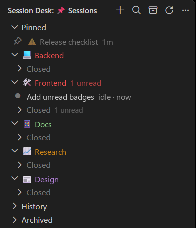

# Session Desk for Claude Code

[](LICENSE)


**Run several Claude Code sessions at once without losing track of them.** Session Desk is a VS Code sidebar that shows, at a glance, which sessions are working, which are waiting for you and which have a reply you haven't read, and lets you keep them in groups with their own color and emoji.

> **Unofficial add-on**, not affiliated with Anthropic. It runs alongside the official Claude Code extension, only reads its files and never changes them.



## Why

Claude Code's own session list is a flat history. Once you have five or ten conversations going (one per project, one per task), you end up clicking through tabs to find the one that finished, the one asking for permission, or the one you named last week. Session Desk turns that list into a desk.

## Features

**Know what's going on**
- 🟢 **Live status**: each session shows if it is *working*, *needs you* or *idle*, read from Claude Code's live registry. The status bar counts them across all VS Code windows.
- 🔵 **Unread replies**: a session that finished while you were elsewhere gets a blue dot, its group shows "N unread", and the dot clears when you open it.
- 🌫️ **Fade**: closed sessions, and sessions idle for a while, are drawn faded, so the ones in use stand out.
- 🏷️ **Real names**: each session shows the title Claude Code gave it, or the one you set.

**Keep it organized**
- 📁 **Groups** with their own emoji and color. Drag a session onto a group to move it.
- 📂 **Open and closed apart**: each group lists its open sessions first; closed ones wait in a collapsed "Closed" section.
- 📌 **Pin** the sessions you always come back to.
- 🗄️ **Archive** a session, or everything older than a date in one go. Archived sessions keep their name, group and color.
- ✏️ Rename, 🎨 color, 😀 emoji, 🔍 search, 🗑️ delete (to the trash), 📋 copy ID or transcript path.

## Requirements

- VS Code 1.85 or later.
- The official **Claude Code** extension (`anthropic.claude-code`), installed and enabled. Session Desk opens sessions with Claude Code's own command, so they open exactly as they would natively.

## Install

Session Desk is not on the Marketplace. Build and install it from source:

```bash
git clone https://github.com/Lamimwork/session-desk.git
cd session-desk
npm install
npx @vscode/vsce package
code --install-extension session-desk-1.0.0.vsix
```

Then reload VS Code, open a workspace where you have used Claude Code, and click the pushpin icon in the activity bar. Hover a row for quick actions (rename, pin, delete); right-click for color, emoji, group, archive and copy.

## Settings

| Setting | Default | What it does |
| --- | --- | --- |
| `sessionDesk.showGroupCounts` | `true` | Show counts next to group names ("(5)", "2 open · 7 closed"). Unread counts are always shown. |
| `sessionDesk.fadeIdleAfterMinutes` | `10` | Fade a session idle for this many minutes. `0` turns off fading of idle sessions (closed ones are always faded). |

## How it works

- Sessions come from Claude Code's local transcripts in `~/.claude/projects/<encoded-workspace>/*.jsonl`.
- Live status comes from the registry Claude Code keeps in `~/.claude/sessions`.
- Both are read-only. Titles are read only when a section is expanded and cached until the transcript changes, so large histories stay fast.
- Your pins, names, groups, colors and emojis live in this extension's own VS Code storage.

## Privacy

Everything stays on your machine. Session Desk only reads local files under `~/.claude`, stores its settings locally and makes **no network requests**.

## Coming from Claude Session Organizer

Session Desk has its own extension ID, so VS Code starts it with empty storage. To bring over your pins, names, groups and colors, copy the old extension's state (the JSON stored in VS Code's `state.vscdb` under the key `sssooonnnggg.claude-session-organizer`) to `import.json` in Session Desk's global storage folder (`.../globalStorage/lamimwork.session-desk/`). It is imported on the next start and renamed to `imported.json`. Settings moved from `claudeSessionOrganizer.*` to `sessionDesk.*`.

## Credits

Session Desk started as a fork of [Claude Session Organizer](https://github.com/sssooonnnggg/claude-session-organizer) by sssooonnnggg (MIT), up to its version 0.7.6: the sidebar, pins, date groups, custom groups, colors, emoji, search and rename come from there. Live status, real names, unread replies, the open/closed split, fading, group colors and emoji, lazy loading and bulk archive were added here.

## License

[MIT](LICENSE)
